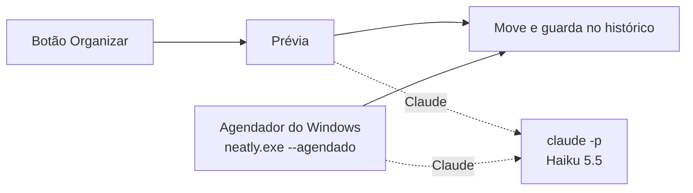

<div align="center">


# Neatly

**Sua pasta Downloads arrumada sozinha, todo dia.**

[](https://github.com/ArturoAndreatta/neatly/actions/workflows/ci.yml)
[](https://github.com/ArturoAndreatta/neatly/releases/latest)

[](LICENSE)


&nbsp;&nbsp;


[**Baixar**](https://github.com/ArturoAndreatta/neatly/releases/latest/download/NeatlySetup.exe) · [Como funciona](#como-funciona) · [Perguntas](#perguntas)

</div>

---

## O que ele faz

O Neatly pega os arquivos soltos na pasta Downloads e guarda cada um numa pasta. Você escolhe como:

- **Claude:** o Claude Haiku 5.5 lê o nome e o começo de cada arquivo e cria pastas por assunto, com subpastas quando faz sentido: `Faculdade/Cálculo II`, `Finanças/Boletos`, `Viagens/Florianópolis`. Ele reaproveita as pastas que você já tem.
- **Script:** separa por tipo, na hora e sem internet: `Imagens`, `Documentos`, `Vídeos`, `Instaladores`... Também reconhece capturas de tela, arquivos do WhatsApp, boletos e notas fiscais.

Antes de mover qualquer coisa, aparece uma **prévia** com a árvore de pastas. Um clique e pronto.

- **Arruma sozinho todo dia** no horário que você escolher. PC desligado na hora? Arruma assim que ligar
- **Nunca apaga nada.** Só move, nunca sobrescreve (nome repetido vira `nome (2).ext`) e não mexe em subpastas nem em arquivo que ainda está baixando
- **Desfaz qualquer arrumação**, apagando as pastas que ela criou
- **Acha qualquer arquivo guardado:** digite parte do nome no histórico
- **Deixa segredo em paz:** `.env`, `.pem`, `.key` e afins ficam onde estão e nunca são enviados ao Claude
- **Se atualiza sozinho** quando sai versão nova

## Instalar

1. **[Baixe o NeatlySetup.exe](https://github.com/ArturoAndreatta/neatly/releases/latest/download/NeatlySetup.exe)**
2. Abra e clique em **Instalar**

Não precisa ser administrador. Quem usava o Neatly 1 (o painel no navegador) recebe o novo pelo botão Atualizar de sempre: modo e horário vêm junto.

> O Windows pode mostrar o aviso do SmartScreen na primeira vez, como faz com qualquer programa novo. Clique em **Mais informações** e **Executar assim mesmo**. O código inteiro está aqui.

## Claude ou Script

| | Script | Claude |
|---|---|---|
| Pastas | Por tipo de arquivo | Por assunto, com subpastas |
| Precisa de | Nada | [Claude Code](https://claude.com/claude-code) e assinatura Pro, Max, Team ou Enterprise |
| Velocidade | Na hora | Alguns segundos |
| Custo | Zero | Um pouco do seu limite (Haiku, o modelo mais leve) |

O modo do botão fica no canto de cima. A arrumação automática tem o modo dela, em **Ajustes**: todo dia num horário e, se quiser, **Arrumar ao ligar o PC** (uns 2 minutos depois de entrar no Windows). As duas só agem se houver algo solto na pasta, sem gastar o Claude à toa, e não repetem se a pasta acabou de ser arrumada. Se o Claude não responder (sem internet, sem login, limite no fim), o Neatly usa o Script e avisa.

## Como funciona



- App em Flutter para Windows, com o motor (`packages/neatly_core`) em Dart puro e testado
- O Claude só recebe nome, tamanho, data e o começo do texto. Ele devolve as pastas; quem move é o Neatly, com as mesmas travas do modo Script
- A arrumação automática é o mesmo `neatly.exe` com `--agendado`: roda escondido, sem janela, numa tarefa só do Agendador (gatilho diário e/ou de logon), que sai junto ao desinstalar
- Ajustes e histórico em `%LOCALAPPDATA%\Neatly`

### Desenvolver

```powershell
flutter pub get
cd packages\neatly_core; dart test; cd ..\..
cd app; flutter run -d windows
```

`NEATLY_PASTA` e `NEATLY_DADOS` trocam a pasta organizada e a pasta de dados, para testar sem mexer na sua Downloads.

## Perguntas

<details>
<summary><b>Pode apagar algum arquivo meu?</b></summary>

Não. Ele só move da raiz de Downloads para subpastas, nunca sobrescreve, e toda arrumação pode ser desfeita no histórico.
</details>

<details>
<summary><b>Minha pasta Downloads está no OneDrive ou em outro disco</b></summary>

Funciona. Ele pergunta ao Windows onde fica a sua Downloads de verdade. Dá para escolher outra pasta em Ajustes.
</details>

<details>
<summary><b>Preciso deixar o Neatly aberto?</b></summary>

Não. A arrumação automática é do Agendador do Windows. Pode fechar a janela.
</details>

<details>
<summary><b>Posso usar no notebook do trabalho?</b></summary>

Pode, ele não pede administrador. Mas vale conferir as regras de TI da empresa e qual conta do Claude usar.
</details>

<details>
<summary><b>Como desinstalo?</b></summary>

Em Configurações do Windows, Aplicativos, Neatly, Desinstalar. Sai o programa, a tarefa diária, os ajustes e o histórico. Seus arquivos ficam exatamente onde estão.
</details>

---

<div align="center">

Feito por [Arturo Andreatta](https://github.com/ArturoAndreatta) · [MIT](LICENSE)

</div>
