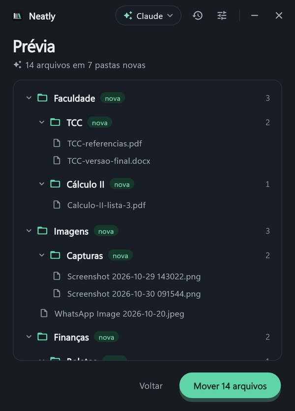

<div align="center">


# Neatly

**Sua pasta Downloads arrumada sozinha, todo dia.**

[](https://github.com/ArturoAndreatta/neatly/actions/workflows/ci.yml)
[](https://github.com/ArturoAndreatta/neatly/releases/latest)

[](LICENSE)

<picture>
  <source media="(prefers-color-scheme: light)" srcset="docs/inicio-claro.jpg">
  
</picture>
&nbsp;&nbsp;
<picture>
  <source media="(prefers-color-scheme: light)" srcset="docs/previa-claro.jpg">
  
</picture>

### [Baixar o Neatly para Windows](https://github.com/ArturoAndreatta/neatly/releases/latest/download/NeatlySetup.exe)

[Instalar](#instalar) · [Modo Claude](#modo-claude) · [Privacidade](#o-que-sai-do-seu-computador) · [Perguntas](#perguntas) · [Desenvolver](#desenvolver)

</div>

---

## O que ele faz

O Neatly pega os arquivos soltos na pasta Downloads e guarda cada um numa pasta. Antes de mover qualquer coisa, mostra uma **prévia** com a árvore de pastas. Um clique e pronto.

Dois jeitos de arrumar:

- **Script:** separa por tipo, na hora e sem internet: `Imagens`, `Documentos`, `Vídeos`, `Instaladores`... Reconhece capturas de tela, arquivos do WhatsApp, boletos e notas fiscais. Funciona para qualquer pessoa, sem conta nenhuma.
- **Claude:** o Claude Haiku 5.5 lê o nome e o começo de cada arquivo e cria pastas por assunto, com subpastas quando faz sentido: `Faculdade/Cálculo II`, `Finanças/Boletos`, `Viagens/Florianópolis`. Reaproveita as pastas que você já tem e aceita pedidos na prévia ("junta as fotos da viagem numa pasta só"). Precisa de uma conta do Claude, [veja abaixo](#modo-claude).

E mais:

- **Arruma sozinho** todo dia no horário que você escolher e, se quiser, ao ligar o PC. PC desligado na hora? Arruma assim que ligar
- **Nunca apaga nada.** Só move, nunca sobrescreve (nome repetido vira `nome (2).ext`) e não mexe em subpastas nem em arquivo que ainda está baixando
- **Desfaz qualquer arrumação** pelo histórico, apagando as pastas que ela criou
- **Acha qualquer arquivo guardado:** digite parte do nome no histórico
- **Deixa segredo em paz:** `.env`, `.pem`, `.key` e afins ficam onde estão e nunca são enviados ao Claude
- **Seu jeito de organizar:** escreva as suas regras ("trabalho sempre em Trabalho/Ano") e o Claude segue
- **Tema claro e escuro**, acompanhando o Windows
- **Se atualiza sozinho** quando sai versão nova

## Instalar

1. **[Baixe o NeatlySetup.exe](https://github.com/ArturoAndreatta/neatly/releases/latest/download/NeatlySetup.exe)**
2. Abra e clique em **Instalar**. Não precisa ser administrador

> **Aviso do SmartScreen:** o Windows avisa na primeira vez porque o instalador não tem assinatura digital paga. Clique em **Mais informações** e depois em **Executar assim mesmo**. O código inteiro está neste repositório, e o instalador é gerado pelo [GitHub Actions](.github/workflows/release.yml) a partir dele.

Pronto: o modo Script já funciona. Para o modo Claude, siga a próxima seção.

## Modo Claude

Você precisa de uma assinatura **Claude Pro, Max, Team ou Enterprise**. O Neatly usa o [Claude Code](https://claude.com/claude-code) instalado no seu PC, com a sua conta, então não há chave de API nem cobrança à parte: cada arrumação gasta um pouco do seu limite de uso, no Haiku, o modelo mais leve.

O Neatly cuida da instalação:

1. Abra **Ajustes** (a engrenagem) e desça até **Claude**
2. **Claude Code não instalado?** Clique em **Instalar**. Abre uma janela com o instalador oficial da Anthropic e, no fim, o login
3. **Nenhuma conta vinculada?** Clique em **Vincular conta**. O navegador abre para você entrar com a sua conta do Claude
4. Volte ao Neatly. Assim que o login termina, aparece **Conta do Claude vinculada** com o seu e-mail

Para trocar de conta, rode `claude auth logout` num terminal e vincule de novo.

Se o Claude não responder (sem internet, conta desvinculada, limite no fim), o Neatly usa o Script e avisa. Nada fica pela metade.

| | Script | Claude |
|---|---|---|
| Pastas | Por tipo de arquivo | Por assunto, com subpastas |
| Precisa de | Nada | Assinatura do Claude |
| Internet | Não | Sim |
| Velocidade | Na hora | Alguns segundos |
| Custo | Zero | Um pouco do seu limite |

O modo do botão principal fica no canto de cima. A arrumação automática tem o modo dela, em **Ajustes**. Ela só age se houver algo solto na pasta, sem gastar o Claude à toa.

## O que sai do seu computador

- **Modo Script:** nada. Tudo acontece no seu PC
- **Modo Claude:** o nome, o tamanho e a data de cada arquivo solto vão para o Claude, pela sua conta, junto com os primeiros 300 caracteres quando é texto ou documento do Office. O conteúdo inteiro, imagens, PDFs e arquivos de segredo (`.env`, `.pem`, `.key`...) nunca vão. O Claude só devolve o nome das pastas; quem move é o Neatly
- **Atualização:** o Neatly consulta os releases deste repositório no GitHub. Não há telemetria nem servidor próprio

## Perguntas

<details>
<summary><b>Pode apagar algum arquivo meu?</b></summary>

Não. Ele só move da raiz de Downloads para subpastas, nunca sobrescreve, e toda arrumação pode ser desfeita no histórico.
</details>

<details>
<summary><b>Não tenho assinatura do Claude. Serve para mim?</b></summary>

Serve. O modo Script não precisa de conta nem de internet, e a arrumação automática funciona igual.
</details>

<details>
<summary><b>Já uso o Claude Code. Preciso fazer algo?</b></summary>

Não. O Neatly acha o Claude Code instalado (instalador oficial, npm ou PATH) e usa a conta que já está nele.
</details>

<details>
<summary><b>Minha pasta Downloads está no OneDrive ou em outro disco</b></summary>

Funciona. Ele pergunta ao Windows onde fica a sua Downloads de verdade. Dá para escolher outra pasta em Ajustes.
</details>

<details>
<summary><b>Preciso deixar o Neatly aberto?</b></summary>

Não. A arrumação automática é do Agendador do Windows. Pode fechar a janela.
</details>

<details>
<summary><b>Posso usar no notebook do trabalho?</b></summary>

Pode, ele não pede administrador. Mas vale conferir as regras de TI da empresa e qual conta do Claude usar.
</details>

<details>
<summary><b>Como desinstalo?</b></summary>

Em Configurações do Windows, Aplicativos, Neatly, Desinstalar. Sai o programa, a tarefa agendada, os ajustes e o histórico. Seus arquivos ficam exatamente onde estão. O Claude Code, se foi instalado pelo Neatly, continua no PC.
</details>

<details>
<summary><b>Achei um problema</b></summary>

Abra uma [issue](https://github.com/ArturoAndreatta/neatly/issues) contando o que aconteceu. O histórico do Neatly (no app) ajuda a mostrar o que foi movido.
</details>

## Como funciona

1. **Olha a pasta.** Pega só os arquivos soltos na raiz de Downloads. Ignora subpastas, arquivos que ainda estão baixando e arquivos de segredo
2. **Monta o plano.** No modo Claude, o Haiku 5.5 escolhe uma pasta por assunto para cada arquivo. No modo Script, a pasta sai do tipo. Se o Claude falhar, vale o Script
3. **Mostra a prévia.** Pelo botão **Organizar**, você vê a árvore de pastas antes e pode pedir ajustes. A arrumação automática pula esta etapa
4. **Move e anota.** Cada movimento vai para o histórico, que permite desfazer

### Por dentro

- App em Flutter para Windows, com o motor (`packages/neatly_core`) em Dart puro e testado
- O modo Claude roda `claude -p` numa pasta vazia, com saída em JSON validada por esquema. A conta é conferida com `claude auth status`
- A arrumação automática é o mesmo `neatly.exe` com `--agendado`: roda escondido, sem janela, numa tarefa só do Agendador (gatilho diário e/ou de logon), que sai junto ao desinstalar
- Ajustes e histórico em `%LOCALAPPDATA%\Neatly`

## Desenvolver

Precisa do [Flutter](https://docs.flutter.dev/get-started/install/windows/desktop) com suporte a Windows.

```powershell
flutter pub get
cd packages\neatly_core; dart test; cd ..\..
cd app; flutter test; flutter run -d windows
```

`NEATLY_PASTA` e `NEATLY_DADOS` trocam a pasta organizada e a pasta de dados, para testar sem mexer na sua Downloads.

| Pasta | O que tem |
|---|---|
| `packages/neatly_core` | Varredura, regras do Script, planejador do Claude, mover e desfazer, agendamento |
| `app` | Interface em Flutter e o modo `--agendado` |
| `installer` | Instalador (Inno Setup) |
| `.github/workflows` | CI em todo push; o release gera e anexa o `NeatlySetup.exe` |

**Publicar versão:** igualar `version` em `app/pubspec.yaml` e `versaoNeatly` em `packages/neatly_core/lib/src/atualizacao.dart`, e criar um release com a tag `vX.Y.Z`. O workflow confere as versões, gera o instalador e anexa. Quem já tem o Neatly recebe o aviso de atualização.

Sugestões e PRs são bem-vindos.

---

<div align="center">

Feito por [Arturo Andreatta](https://github.com/ArturoAndreatta) · [MIT](LICENSE)

</div>
