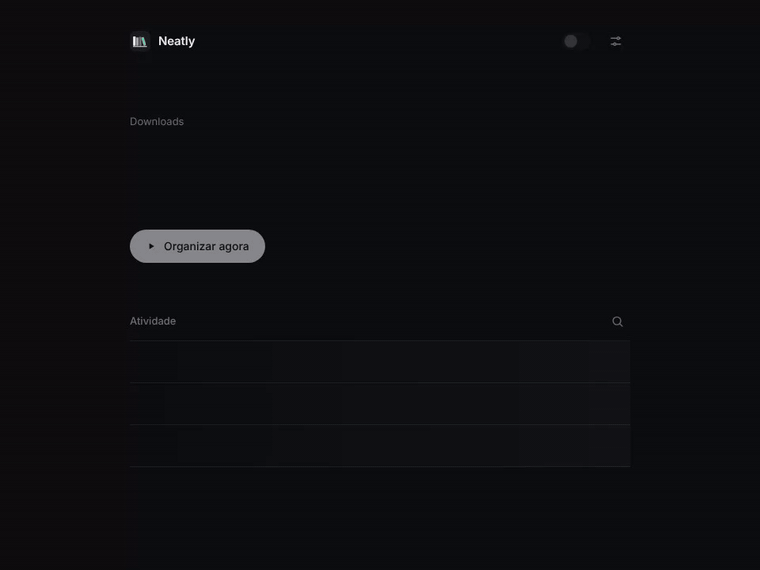
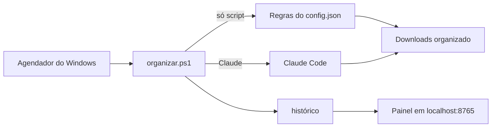

<div align="center">


# Neatly

**Sua pasta Downloads arrumada sozinha, todo dia.**

[](https://github.com/ArturoAndreatta/neatly/actions/workflows/ci.yml)
[](https://github.com/ArturoAndreatta/neatly/releases/latest)

[](LICENSE)



[**Baixar**](https://github.com/ArturoAndreatta/neatly/releases/latest/download/Neatly.zip) · [Como funciona](#como-funciona) · [Perguntas](#perguntas)

</div>

---

## O que ele faz

Todo dia, no horário que você escolher, o Neatly pega os arquivos soltos na pasta Downloads e guarda cada um na sua gaveta: `Imagens`, `Documentos`, `Instaladores`, `Vídeos`, `Áudio`, `Compactados`...

- **Não perde rodada.** PC desligado no horário? Ele organiza assim que você ligar
- **Nunca apaga nada.** Só move, nunca sobrescreve, não mexe em subpastas nem em arquivo que ainda está baixando
- **Desfaz qualquer rodada** com um clique
- **Acha qualquer arquivo:** digite parte do nome e ele mostra pra onde foi
- **Deixa segredo em paz:** `.env`, `.pem`, `.key` e afins ficam onde estão
- **Se atualiza sozinho:** quando sai versão nova, aparece o aviso no painel
- **Claude opcional:** funciona com regras fixas, sem IA. Se você tem o Claude Code, o Claude Haiku pode fazer o serviço

## Instalar

1. **[Baixe o Neatly.zip](https://github.com/ArturoAndreatta/neatly/releases/latest/download/Neatly.zip)** e extraia em qualquer lugar
2. Dê dois cliques em **`instalar.cmd`**
3. Pronto. O painel abre no navegador

Não precisa ser administrador. Ou, se preferir, uma linha no PowerShell:

```powershell
irm https://raw.githubusercontent.com/ArturoAndreatta/neatly/main/instalar-web.ps1 | iex
```

> O Windows pode mostrar um aviso de segurança na primeira vez, como faz com qualquer script baixado. Clique em **Executar**. O código inteiro está aqui pra quem quiser conferir.

## Usar

Depois de instalado, não precisa fazer nada. Quando quiser ver o que aconteceu, abra o atalho **Neatly**.

O painel mostra só o que importa: quantos arquivos estão soltos, quando é a próxima arrumação e o que foi feito em cada rodada. Horário, modo e pastas ficam em **Ajustes**, no canto.

## Claude ou só script

| | Só script | Claude |
|---|---|---|
| Precisa de | Nada | [Claude Code](https://claude.com/claude-code) e assinatura Pro, Max, Team ou Enterprise |
| Velocidade | Instantâneo | Alguns segundos |
| Custo | Zero | Um pouco do seu limite (Haiku, o modelo mais leve) |

No modo Claude, o Neatly mede quanto do seu limite de 5h e semanal cada rodada gastou e mostra a média por semana em **Ver números**.

Para rodar sozinho, o Claude precisa de um token de 1 ano (o jeito oficial, gerado pelo próprio Claude Code). O instalador oferece configurar na hora. O token fica criptografado com a proteção do Windows: só o seu usuário consegue ler.

## Personalizar

Em **Ajustes → Abrir pasta de dados**, edite o `config.json`:

```jsonc
{
  "modo": "script",
  "minutosRecentes": 10,
  "categorias": {
    "Imagens": ["png", "jpg", "webp"],
    "Planilhas": ["xlsx", "csv"]
  },
  "ignorar": ["*.env", "*.pem", "*.key"]
}
```

Vale a partir da próxima rodada.

## Como funciona



- Tudo em PowerShell e HTML, sem instalar nada a mais
- Roda escondido, sem janela piscando
- O painel só responde pro seu próprio PC e exige um código gerado a cada abertura: nenhum site consegue mexer nele
- Testado a cada mudança num Windows de verdade (PowerShell 5.1 e 7)
- Arquivos do programa em `%LOCALAPPDATA%\Neatly`

## Perguntas

<details>
<summary><b>Pode apagar algum arquivo meu?</b></summary>

Não. Ele só move da raiz de Downloads pra subpastas. Nome repetido vira `nome (1).ext`. E toda rodada pode ser desfeita.
</details>

<details>
<summary><b>Minha pasta Downloads está no OneDrive ou em outro disco</b></summary>

Funciona. Ele pergunta pro Windows onde fica a sua pasta Downloads de verdade.
</details>

<details>
<summary><b>O painel fica ligado o tempo todo?</b></summary>

Fica, e é leve: um processo parado esperando você abrir a página. Dá pra fechar em Ajustes. A organização continua com ele fechado.
</details>

<details>
<summary><b>Como ele mede o limite do Claude?</b></summary>

A cada resposta, o Claude Code informa quanto da janela de 5h e do limite semanal já foi usado. O Neatly guarda a primeira e a última leitura da rodada. Se a janela de 5h reiniciar no meio, ele soma o antes e o depois. Uso do Claude em outro lugar durante a rodada entra na conta.
</details>

<details>
<summary><b>Posso usar no notebook do trabalho?</b></summary>

Pode, ele não pede administrador. Mas vale conferir as regras de TI da empresa sobre scripts e qual conta do Claude usar.
</details>

<details>
<summary><b>Como desinstalo?</b></summary>

Dois cliques em `desinstalar.cmd` (no zip ou na pasta de dados). Remove tarefas e atalhos e pergunta se quer apagar o histórico. Seus arquivos ficam exatamente onde estão.
</details>

---

<div align="center">

Feito por [Arturo Andreatta](https://github.com/ArturoAndreatta) · [MIT](LICENSE)

</div>
