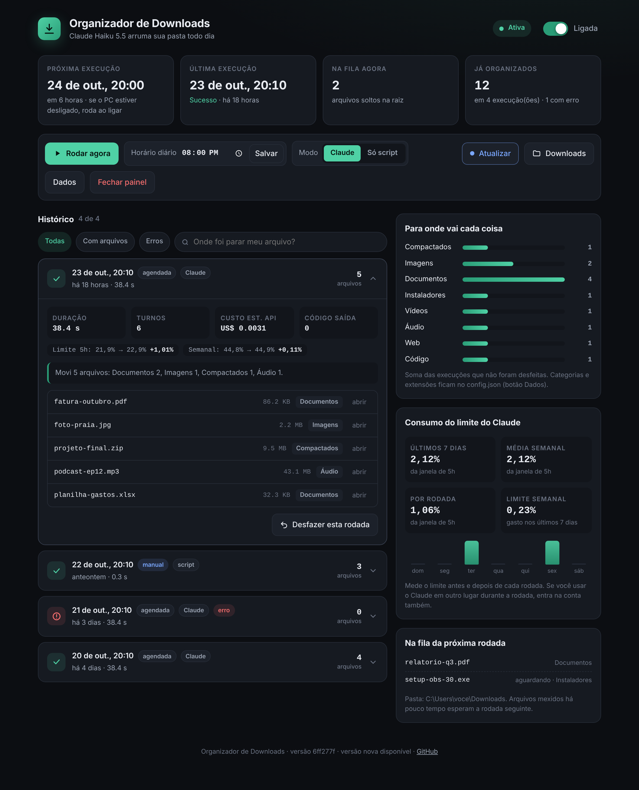
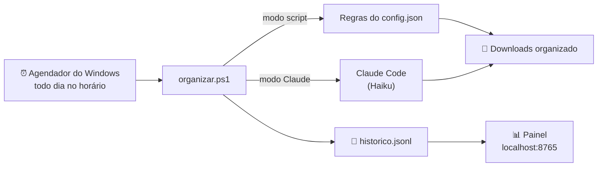

<div align="center">

# 📥 Organizador de Downloads

**Sua pasta Downloads arrumada sozinha, todo dia.**
Separa por tipo de arquivo, mostra tudo num painel bonito e deixa desfazer qualquer rodada.




</div>

---

## ✨ O que ele faz

| | |
|---|---|
| 🗂️ **Organiza sozinho** | Todo dia, no horário que você escolher, move os arquivos soltos para `Imagens`, `Documentos`, `Instaladores`, `Vídeos`... |
| ⏰ **Não perde rodada** | PC desligado no horário? Ele roda assim que você ligar. |
| 📊 **Painel no navegador** | Liga e desliga, troca o horário, roda na hora, vê o histórico completo. |
| 🔍 **"Onde foi parar meu arquivo?"** | Digita parte do nome e ele mostra para qual pasta foi, com botão para abrir no Explorer. |
| ↩️ **Desfazer** | Não gostou de uma rodada? Um clique e os arquivos voltam para onde estavam. |
| 🛡️ **Cuidadoso** | Nunca apaga nada, nunca sobrescreve, não mexe em subpastas, ignora arquivos baixando e arquivos com cara de senha (`.env`, `.pem`, `.key`...). |
| 📈 **Mede o consumo do Claude** | Guarda o limite de 5h e o semanal antes e depois de cada rodada e mostra a média por semana. Se a janela de 5h reiniciar no meio da rodada, ele conta certo. |
| 🔄 **Atualiza com um clique** | Quando sai versão nova aqui no GitHub, aparece o botão **Atualizar** no painel, com a lista do que mudou. |
| 🤖 **Claude opcional** | Funciona só com regras fixas, sem IA. Se você tem o Claude Code, pode deixar o Claude Haiku fazer o serviço. |

---

## 🚀 Instalação (1 minuto)

### Jeito mais fácil

1. Clique em **[⬇️ Baixar ZIP](https://github.com/ArturoAndreatta/organizador-downloads/archive/refs/heads/main.zip)**
2. Extraia o ZIP em qualquer lugar
3. Dê dois cliques em **`instalar.cmd`**
4. Responda as perguntas (são no máximo duas). O painel abre sozinho no final

> 💡 Se o Windows mostrar um aviso de segurança, clique em **Executar** (ou **Mais informações → Executar assim mesmo**). Isso aparece para qualquer script baixado da internet. O código está todo aqui no repositório para quem quiser conferir.

### Jeito rápido (uma linha no PowerShell)

```powershell
irm https://raw.githubusercontent.com/ArturoAndreatta/organizador-downloads/main/instalar-web.ps1 | iex
```

✅ Não precisa ser administrador. Tudo fica só no seu usuário.

---

## 🖱️ Como usar

Depois de instalado, você não precisa fazer nada: ele roda sozinho.

Quando quiser ver o que aconteceu, abra o atalho **Organizador de Downloads** (na área de trabalho ou no menu Iniciar). O painel abre no navegador, em `http://localhost:8765`.

| No painel | Para que serve |
|---|---|
| **Interruptor no topo** | Pausa ou liga a organização automática |
| **Rodar agora** | Organiza na hora, sem esperar o horário |
| **Horário diário** | Muda quando ele roda |
| **Modo** | Alterna entre *Claude* e *Só script* |
| **Histórico** | Clique numa rodada para ver os arquivos, o resumo e desfazer |
| **Atualizar** | Aparece quando tem versão nova. Mostra o que mudou e atualiza sem perder nada |
| **Consumo do limite** | Quanto do seu limite do Claude as rodadas gastaram: últimos 7 dias, média semanal e por rodada |
| **Dados** | Abre a pasta com `config.json`, histórico e o `configurar-token.cmd` |

---

## 🤖 Claude ou só script?

| | 🧩 Só script | 🤖 Claude |
|---|---|---|
| **Precisa de quê** | Nada | [Claude Code](https://claude.com/claude-code) + assinatura Pro, Max, Team ou Enterprise |
| **Velocidade** | Instantâneo | Alguns segundos |
| **Custo** | Zero | Usa um pouquinho do seu limite (modelo Haiku, o mais leve) |
| **Bom para** | Quem só quer a pasta arrumada | Quem já usa o Claude e quer evoluir para regras mais espertas |

O instalador detecta se você tem o Claude Code. Se não tiver, já instala no modo script.

### Configurando o Claude

Para rodar sem ninguém olhando, o Claude precisa de um **token de 1 ano** (é o jeito oficial, gerado pelo próprio Claude Code). O instalador oferece configurar na hora. Se pular, faça depois:

> Painel → **Dados** → dois cliques em **`configurar-token.cmd`**

O token fica salvo criptografado com a proteção do Windows: só o seu usuário consegue ler.

---

## ⚙️ Personalizando

Clique em **Dados** no painel e abra o `config.json`:

```jsonc
{
  "modo": "script",              // "script" ou "claude"
  "modelo": "claude-haiku-5-5",  // modelo usado no modo Claude
  "minutosRecentes": 10,         // arquivos mexidos há menos tempo esperam a próxima rodada
  "categorias": {
    "Imagens": ["png", "jpg", "jpeg", "gif", "webp"],
    "Planilhas": ["xlsx", "csv"]  // crie as pastas que quiser
  },
  "ignorar": ["*.env", "*.pem", "*.key", "*credentials*"]  // nunca mexe nesses
}
```

A mudança vale a partir da próxima rodada. Não precisa reinstalar.

---

## 🧠 Como funciona por dentro



- Tudo roda escondido, sem janela piscando.
- O painel é um servidorzinho local em PowerShell. Só responde para o seu próprio PC e exige um código secreto gerado a cada vez que abre, então nenhum site consegue mexer nele por trás.
- Arquivos do programa ficam em `%LOCALAPPDATA%\OrganizadorDownloads`.

---

## ❓ Perguntas frequentes

<details>
<summary><b>Ele pode apagar algum arquivo meu?</b></summary>

Não. Ele só **move** arquivos da raiz de Downloads para subpastas. Se já existir um arquivo com o mesmo nome, ele cria `nome (1).ext`. E qualquer rodada pode ser desfeita pelo painel.
</details>

<details>
<summary><b>Minha pasta Downloads está no OneDrive ou em outro disco. Funciona?</b></summary>

Funciona. Ele pergunta ao Windows onde fica a sua pasta Downloads de verdade.
</details>

<details>
<summary><b>O painel fica ligado o tempo todo? Pesa?</b></summary>

Fica, e é bem leve: um processo do PowerShell parado esperando você abrir a página. Se quiser, o botão **Fechar painel** desliga até o próximo login. A organização automática continua funcionando com o painel fechado.
</details>

<details>
<summary><b>Apareceu erro de login do Claude no histórico</b></summary>

O token expirou ou não foi configurado. Painel → **Dados** → `configurar-token.cmd`. Ou troque para o modo **Só script**.
</details>

<details>
<summary><b>Como ele mede o consumo do limite do Claude?</b></summary>

A cada resposta, o Claude Code informa quanto da janela de 5 horas e do limite semanal já foi usado. O programa guarda a primeira e a última leitura de cada rodada e soma a diferença. Se a janela de 5h reiniciar no meio, ele soma o que foi gasto antes e depois do reinício. Vale saber: se você estiver usando o Claude em outro lugar durante a rodada, esse uso entra na conta também.
</details>

<details>
<summary><b>Posso usar no notebook do trabalho?</b></summary>

Pode, ele não precisa de administrador. Mas vale conferir as regras de TI da empresa sobre scripts e, no modo Claude, sobre qual conta do Claude usar.
</details>

<details>
<summary><b>Como atualizo?</b></summary>

Pelo próprio painel: quando sai versão nova, aparece o botão **Atualizar** com a lista do que mudou. Um clique e pronto. Configuração, histórico, horário e token são mantidos.

Se preferir, também dá para baixar de novo e rodar o `instalar.cmd`.
</details>

---

## 🗑️ Desinstalar

Dois cliques em **`desinstalar.cmd`** (no ZIP ou no painel → **Dados**). Ele remove as tarefas e os atalhos e pergunta se você quer apagar o histórico. Seus arquivos nos Downloads ficam exatamente onde estão.

---

<div align="center">

Feito por [Arturo Andreatta](https://github.com/ArturoAndreatta) · Licença [MIT](LICENSE)

Gostou? Deixa uma ⭐ que ajuda outras pessoas a acharem.

</div>
